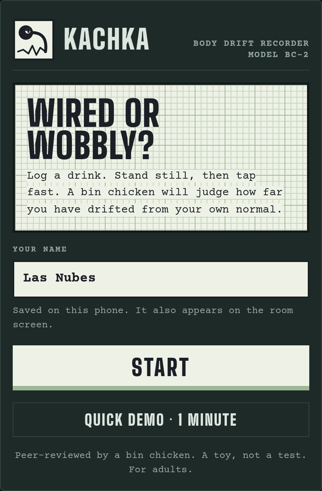
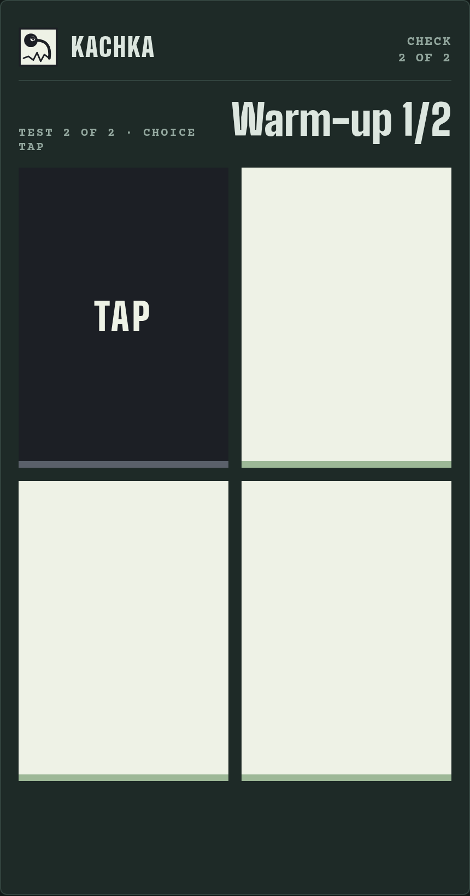
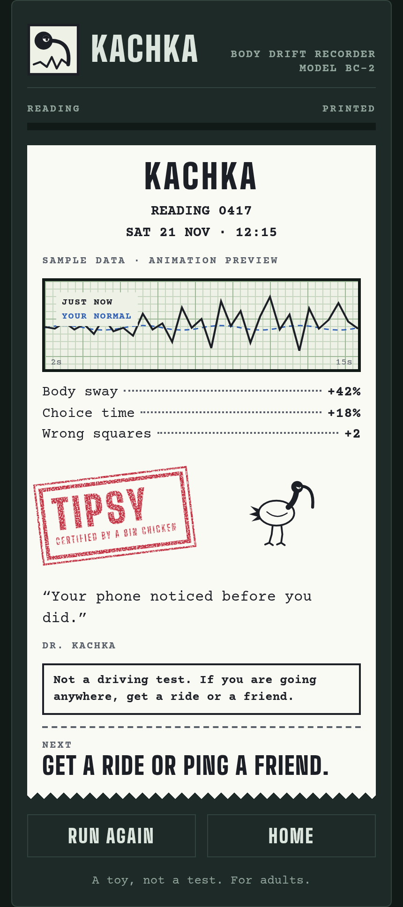

# KACHKA

**Wired or wobbly?** Log a drink. Stand still, then tap fast. A bin chicken will judge how far you have drifted from your own normal.

A mobile-first **body drift recorder**, built by **Las Nubes** (Spanish for **“The Clouds”**) at the Tanda AI Hackathon 2026 in Brisbane. Your phone is the instrument; a printed receipt is the result.

**[Try Kachka](https://kachka.fun)** · [Run locally](#run-locally) · [Documentation](docs/README.md) · [Why Kachka?](#why-kachka)

## Why Kachka?

**KACHKA** is pronounced **KATCH-ka**, with the stress on the first syllable. In Russian, *качка* means the rolling and pitching of a ship. In Ukrainian, *качка* means a duck. Our instrument measures sway, and a bird signs the receipt: the name does both jobs.

```text
DR. KACHKA
Body drift recorder · Model BC-2
Peer-reviewed by a bin chicken
```

> “Kachka is what Russian sailors call it when the ship won't hold still. It's also Ukrainian for duck. We measure one and we're signed off by the other.”

Read the full [naming story](docs/13-the-name.md) for the pronunciation, mascot and instrument identity.

> A toy, not a test. For adults. Kachka is not a medical or legal measurement and must never be used to decide whether to drive. If you are going anywhere after drinking, get a ride or a friend.

## The idea

A coffee, a drink, a long day: you might feel different, but what changed? Kachka starts with **your own baseline**, then compares later readings against it. It measures change in a few phone-based tasks, rather than comparing you with somebody else's “normal.”

The experience borrows from an old scientific instrument: a dark green casing, graph paper, physical-looking keys and a thermal-paper receipt. **Dr. Kachka**, our bin chicken, supplies the deadpan commentary.

### From your normal to your receipt

1. **Record your normal.** Take a short standing and/or tapping test. If you have already had something, the baseline is labelled accordingly.
2. **Log what you have had.** Coffee, energy drink, beer, wine or spirit, in one tap. You can also choose **Just log a drink** on your first visit and skip the tests entirely.
3. **Run another check.** Compare body sway and tapping speed/accuracy with your baseline. Add a camera pulse reading if you want to try it.
4. **Read the receipt.** See the change, a **Steady / Wired / Tipsy / Wobbly** stamp, a line from the bird and a practical nudge. Save the receipt as an image, or share it where your browser supports image sharing.

**The sensors measure the change; the drink log gives that change a label.** These labels are not a measurement of what is in your body. A Steady result is never clearance to drive.

## A look inside

<table>
  <tr>
    <th>Meet the instrument</th>
    <th>Try Choice Tap</th>
    <th>Get your receipt</th>
  </tr>
  <tr>
    <td valign="top"></td>
    <td valign="top"></td>
    <td valign="top"></td>
  </tr>
</table>

Screenshots show the running app at a mobile viewport. The receipt uses **sample data** from the app's preview screen, not a real person's reading. [Capture details](docs/screenshots/README.md).

## What is built

| Part | What it does |
|---|---|
| **Stand Still** | Records phone motion over a ten-second task and checks recording quality and baseline compatibility. It does not clinically measure balance or impairment. |
| **Choice Tap** | Measures reaction time and accuracy across four squares, with two warm-ups and eight scored taps. |
| **Camera pulse (experimental)** | Optional finger-on-camera pulse estimate. Only a sufficiently supported **measured** result can affect a comparison when a compatible pulse baseline exists; **approximate or combined** readings are display-only. Real-phone accuracy is not yet validated. |
| **Drink log** | Records coffee, tea, energy drinks and alcohol locally. The detailed editor supports serving quantities, fractions and approximate consumption times; the quick path works without taking any tests. |
| **Caffeine field guide** | Distinguishes product-label quantities, personal estimates, app defaults and unknown amounts. Shows a *modelled*, not measured, caffeine timeline with selectable **2 / 5 / 8-hour half-life scenarios**, a bedtime marker and explanations of missing data. |
| **Receipt** | Keeps the original Steady / Wired / Tipsy / Wobbly stamps, Dr. Bin Chicken's jokes, animations and paper design. Saves a PNG or uses browser-supported sharing, with optional personal details hidden by default and required alcohol safety text retained. |
| **Public Room** | Anyone may **watch** without joining. Live presence is separately opt-in for the current tab; publishing a recent ticket requires reviewing and explicitly choosing its nickname, verdict, score and personal/simulated label. No leaderboard is displayed. |
| **Demo modes** | A quick entry from the landing screen, plus an optional challenge using your other hand or a spin where motion is available. |

The quick demo skips recording a personal baseline. It compares against fixed example numbers, chosen on build day and not drawn from any study, offers each test once with skip controls, and labels the result **Simulated** and **Example reference, not your baseline** on the screen, after a reload and on a saved receipt. It never writes those numbers into your personal baseline. The example has standing and tapping values only, so a camera pulse reading is shown but not compared. The wearable ring and motion magnifier discussed in early plans are not part of the current app flow.

## Wellbeing information and safety

Kachka provides **self-observation and educational context, not healthcare, diagnosis or treatment**. It does not measure caffeine or alcohol in your body, establish intoxication or sobriety, assess medical fitness, or determine whether you are safe to drive. A **Steady** stamp is not a safety clearance.

The caffeine curve uses quantities entered in the drink log, an illustrative **50-minute rise** and **2-, 5- and 8-hour half-life scenarios**. These are modelling assumptions, not individual blood-caffeine measurements or predictions of sleep quality. Amounts from a label are identified separately from editable defaults and estimates. Missing amounts are disclosed; when all quantities are unknown, Kachka does not draw a misleading caffeine curve. The optional field guide explains what an actual logged serving contributes to the modelled bedtime figure.

When relevant alcohol is logged, the fixed **do-not-drive / get-a-ride** safety message is preserved on the displayed receipt and saved PNG—even if the result is Steady or optional name/drink details are hidden. Task changes cannot prove a drink caused them. The camera and motion tools are experimental phone-based features; synthetic software checks have passed, but physical-device performance and reference-instrument agreement remain unverified.

## How it works

**React + TypeScript + Vite** render the app. A local, rule-based scoring engine compares sensor metrics with the saved baseline. A **Hono** server provides the room board and the optional Claude commentary endpoint.

Original Dr. Bin Chicken commentary is built in. **Optional paid Claude commentary is disabled by default** and needs explicit server enablement, a server-only API key and a positive call allowance. AI never decides measurements, verdicts or mandatory safety text. The instrument works without paid AI.

Baseline readings and drink history are stored in the browser's `localStorage`; raw motion samples and camera frames are not sent to the room. The optional verdict endpoint can receive bounded numerical summaries and fixed categories. If paid commentary is enabled, a limited summary—not raw sensor data or names—is sent to the provider.

The Room is **public**. Opening or watching it publishes nothing. Turning on live participation shares a nickname and coarse activity **for the current tab only**; a fresh page load does not silently restore consent. Publishing a ticket is a separate Privacy-screen action, after a preview of the nickname, verdict, score and simulated/personal status. **Public API readers can still see scores on explicitly shared tickets**, even though the projector has no ranking display. Drink history, raw sensor measurements and the baseline are not published.

Turning participation off stops new client reports and requests withdrawal. If removal cannot be confirmed, Kachka keeps the minimum random handle needed to retry while keeping sharing off. A saved receipt or somebody else's screenshot cannot be recalled. There are no user accounts; the [Privacy screen](https://kachka.fun/privacy) explains the current choices and limitations.

## Run locally

Requires **Node.js 22 or newer** and npm.

```bash
npm ci --no-audit --no-fund
npm run dev
```

Vite serves the web app on port **5173** and proxies `/api` to the Hono server on **3333**. Open `/lab` for links to individual instruments and screens; `/result?preview` shows sample receipts.

```bash
npm run check   # TypeScript check and unit tests
npm run build   # Client in dist/; server in dist-server/
npm start       # Serve the built app and API together on port 3333
```

Stop the development server before using `npm start` on the same port. `GET /api/health` reports server health.

### Optional server configuration

The default local workflow needs **no API key or Redis service**. [.env.example](.env.example) documents the settings. The server reads its process environment; the npm commands do not automatically load a `.env` file. Export values securely in your shell or configure them in your hosting environment.

| Variable | Purpose |
|---|---|
| `ANTHROPIC_API_KEY` | Server-side key for optional Claude commentary. Leave unset for built-in lines. |
| `VERDICT_MODEL` | `claude-haiku-5-5` by default; `claude-sonnet-5-5` is also supported. |
| `VERDICT_ENABLED` | Defaults to `false`; must explicitly be `true` for paid commentary. |
| `VERDICT_DAILY_CALL_LIMIT` | Defaults to `0`. Paid calls additionally require a key and positive per-process daily allowance. This is **not** a provider-side monetary spending cap. |
| `REDIS_URL` | Optional room-board persistence across restarts. Without it, the board lives in memory. Configure authentication and persistence for durable room deletion. |
| `TRUSTED_PROXY_IPS` | Exact trusted proxy peers only. Leave empty unless the production ingress chain and origin isolation are verified. |
| `ROOM_ADMIN_TOKEN` | Optional token of at least 16 characters for the room reset endpoint. Unset disables that endpoint. |
| `ROOM_NAMES` | `typed` by default; `generated` substitutes generated nicknames on the room board. |
| `PORT` | Listening and container health-check port; defaults to `3333`. |

Keep credentials in server-side environment settings. Never commit them or put them in the browser bundle.

### Phone and browser notes

- Use **HTTPS on a real phone** for motion and camera access. iOS motion permission must begin with a user tap.
- When motion data is unavailable, the app can use Choice Tap. A run needs at least one scored standing or tapping test; pulse alone is not enough.
- Camera pulse is experimental and depends on the camera, lighting and a still finger. It is optional and skippable.
- Image sharing depends on browser support; saving the receipt is the alternative.
- A desktop screenshot or unit test cannot establish that a phone's sensors work. Test physical devices separately.

## Release readiness

**Status: engineering release candidate / staging review, not certified for unrestricted public or medical use.** The repository contains software regression checks, an isolated Redis recovery exercise, a deployment revision verifier and physical-phone testing instructions. They do not replace testing on real iPhone/Safari and Android/Chrome devices, synchronized pulse/reference measurement, native Save/Share and assistive-technology checks.

Production deployment is initiated by merging into `main`. A passing CI build or accepted Dokploy webhook is not proof of ongoing application health, correct Redis persistence or a privacy-safe rollback. Verify the deployed commit, one active room writer, the actual Redis setup and a retained **Phase F-or-later** rollback image before rollout. Earlier images can reintroduce automatic room posting or rankings.

Before wide commercial distribution, confirm rights and attribution for all Las Nubes code/artwork/mascot/receipt assets and obtain appropriate Australian privacy, claims and consumer-law review. Never present Kachka as a sobriety test or a validated medical device.

- [Phase G release-readiness matrix and operator runbook](docs/portfolio/PHASE-G.md)
- [Physical-device pilot and test kit](docs/portfolio/phase-g-device-pilot.md)
- [Scientific, privacy, licensing and cost evidence](docs/portfolio/PHASE-G-COMMERCIAL.md)

## Explore the project

- [Architecture, contracts and scoring](docs/05-architecture.md)
- [Screen specifications](docs/04-screens-spec.md)
- [Seismograph design system](docs/design/DESIGN.md)
- [Product and engineering decisions](DECISIONS.md)
- [Full documentation index](docs/README.md)
- [Hackathon event and planning archive](docs/archive/hackathon-2026.md)

Some specifications preserve earlier plans. The source and later decisions show what is implemented today; the archive is context, not a current release checklist.
